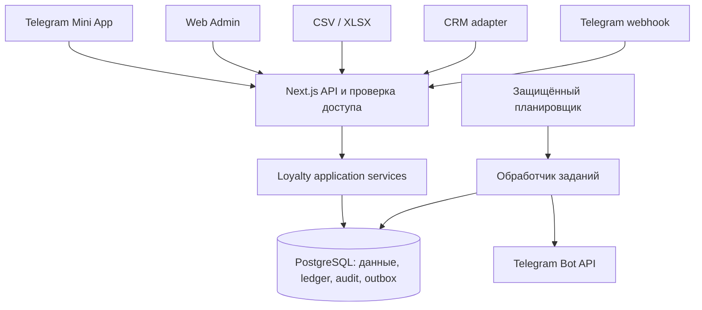

# RPM Club — спецификация реализации MVP 1.0

Версия: 1.1 · Актуализировано: 20 сентября 2026 · Язык интерфейса: русский.

Основание: [RPM Club TZ.pdf](<C:/Users/wthtw/Downloads/Telegram Desktop/RPM Club TZ.pdf>), 22 страницы, редакция от 21 августа 2026.

Статус: спецификация актуализирована по действующему составу продукта. Недостающие бизнес-правила сформулированы как предлагаемые решения в §2. Они не считаются уже согласованными условиями программы. До запуска на реальных клиентах владелец продукта фиксирует решения, влияющие на деньги, исторические начисления и обработку данных.

Документ описывает сервер, клиент, админку, эксплуатацию и приёмку. Последующие изменения программы, заявок, контента и уведомлений описаны в [правках сентября](SEPTEMBER-CHANGES.md); актуальный доступ сотрудников — в [инструкции входа](ADMIN-BOT-LOGIN.md).

## 1. Продукт и границы

**RPM CLUB — «Ваш статус внутри RPM».** Завершённая оплаченная аренда увеличивает сумму аренд, приносит RPM Bonus, повышает статус и открывает привилегии. Цель — увеличить повторные аренды.

В поставку входят:

- Telegram Bot и Mini App: авторизация, подтверждение телефона, onboarding, Главная, Club, История, Профиль.
- Пять уровней, прогресс, привилегии и цифровая membership card.
- Транзакционный учёт Bonus: начисления, списания, сроки действия, отмены и реферальные награды.
- Веб-админка с ролями, импортом CSV/XLSX, настройками и журналом действий.
- RPM Drops, Telegram-уведомления и реферальная программа.
- Работающий универсальный endpoint приёма аренд; подключение конкретной CRM выполняется отдельно после получения её контракта.
- Миграции, тестовые данные, автоматические проверки, документация запуска и восстановления.

Вне MVP: собственный каталог и бронирование, онлайн-оплата, платёжная карта, native-приложения, наличие машин в реальном времени, автоматическая выдача доставок/upgrade, перевод Bonus, gift cards, партнёрская сеть, достижения, рейтинги, AI и динамические цены. Предоставление физических привилегий контролирует сотрудник вручную.

«Выбрать автомобиль» всегда открывает существующий [каталог RPM](https://rpmrent.ru/cars). В интерфейсе используются «Сумма аренд в RPM» и «Сумма завершённых аренд». Названия «дисконтная карта», RPM Loyalty и «сумма покупок» не применяются.

## 2. Неоднозначности ТЗ и предлагаемые решения

Обозначения: **ТЗ** — исходное требование; **Решение** — конкретизация для реализации; **Запуск** — внешние данные или бизнес-решение, необходимое до production. Все технические параметры, отсутствующие в ТЗ, являются проектными решениями этой спецификации.

| ID | Неопределённость | Решение для реализации |
|---|---|---|
| D01 | На стр. 5 tier пересчитывается до начисления; на стр. 13 — после | Использовать ставку уровня, достигнутого с учётом новой аренды, на всю эту аренду. 287 000 + 35 000 ₽ → BLACK → 1 400 Bonus. Это предлагаемое разрешение противоречия; зафиксировать до реальных начислений. |
| D02 | Статус учитывает оплату, но в импорте есть только `completed` | Добавить `payment_status`. Без подтверждения полной оплаты экономический эффект запрещён. Старый формат принимать только через явно выбранный администратором профиль «completed означает completed + paid», с записью в аудит. |
| D03 | Не определено начисление по старой истории | Начальный импорт по умолчанию даёт сумму аренд и tier, но не создаёт новый cashback. Подтверждённый старый баланс переносится отдельными входящими начислениями со сроками действия. Значения 8 420 Bonus из примера ТЗ не являются формулой миграции. |
| D04 | Нет округления и базы после скидок | Денежные суммы — целые копейки. Bonus — целые единицы; cashback округляется вниз. База начисления и статуса — реально оплаченная стоимость самой аренды после скидок, включая скидку Bonus; доплаты исключаются. |
| D05 | Нет сценария использования Bonus | Сотрудник фиксирует скидку в существующей системе RPM и списывает Bonus через админку, указывая внешний ID аренды и стоимость до скидки Bonus. Лимит 20% применяется к этой стоимости. Онлайн-оплата не добавляется. |
| D06 | Нет поведения при отмене и уже потраченных начислениях | Отмена компенсирующими транзакциями. Сумма аренд уменьшается, достигнутый уровень сохраняется. При нехватке Bonus образуется внутренний дефицит; доступно к использованию 0, новые начисления сначала покрывают дефицит. Денежный долг клиенту не выставляется. |
| D07 | Ручное изменение tier конфликтует с запретом понижения | Ручное действие может только повысить сохраняемый уровень. Снять пометку override можно, но уже достигнутый уровень не снижается. Понижение через админку в MVP отсутствует. |
| D08 | Нет истории настроек и правил перерасчёта | Публикация настроек создаёт версию. Старые начисления и сроки действия не меняются. Новые пороги могут повысить текущие уровни фоновым пересчётом, но не понизить их. |
| D09 | Не определён «новый клиент» для referral | У клиента не должно быть ни одной учтённой завершённой оплаченной аренды, включая историю до регистрации. Пригласивший закрепляется один раз при активации; награды выдаются после первой подходящей аренды. |
| D11 | Синхронизация описана без повторных попыток | Начисления и задания на внешнюю доставку сохраняются одной транзакцией PostgreSQL. Сбой Telegram не отменяет аренду; доставка повторяется отдельно. |
| D12 | Не определены часовой пояс и дата старта | Бизнес-календарь — Europe/Moscow; timestamps — UTC. Дата старта `program_starts_at` обязательна перед production и отделяет исторический импорт от новых начислений. |

D01–D09 и D12 должны быть отражены в правилах программы и настройках запуска. До их фиксации разрешены разработка и тестовые данные; реальный экономический перенос не выполняется автоматически.

## 3. Участники и права

Клиент имеет только доступ к собственному счёту и предназначенным ему предложениям. Сотрудники входят отдельно через Supabase Auth; регистрация сотрудников по общедоступной ссылке выключена.

| Возможность | Клиент | viewer | manager | admin |
|---|---|---|---|---|
| Карта, история, профиль, referral | Свои | Просмотр клиентов | Просмотр клиентов | Просмотр клиентов |
| Просмотр клиентов и Dashboard | Нет | Да | Да | Да |
| Добавление, импорт и отмена аренды | Нет | Нет | Да | Да |
| Списание для аренды, ручное начисление/списание | Нет | Нет | Да, причина обязательна | Да, причина обязательна |
| Создание и публикация Drops | Нет | Нет | Да | Да |
| Изменение уровня, блокировка, восстановление | Нет | Нет | Нет | Да |
| Настройки экономики и публикация документов | Нет | Нет | Нет | Да |
| Исторический перенос/конфликт идентичности | Нет | Нет | Нет | Да |
| Audit Log | Нет | Нет | Нет | Да |
| Управление сотрудниками и ключами интеграции | Нет | Нет | Нет | Да |

Роль хранится на сервере в `admin_memberships`, а не в редактируемых пользователем метаданных. Проверка выполняется при каждом действии API. Изменение роли/блокировка действует на следующий запрос, независимо от срока жизни JWT.

## 4. Пользовательские истории

1. Как новый клиент, я хочу открыть клуб из Telegram, чтобы вступить без установки приложения.
2. Как клиент, я хочу подтвердить свой номер и принять правила, чтобы безопасно связать профиль с историей RPM.
3. Как существующий клиент, я хочу увидеть прошлые аренды и полученный статус, чтобы продолжить участие с накопленным прогрессом.
4. Как клиент без истории, я хочу получить MEMBER и понятную цель до DRIVE, чтобы знать следующий шаг.
5. Как клиент, я хочу видеть карту, доступные Bonus и прогресс, чтобы понимать свои возможности.
6. Как клиент, я хочу сравнить уровни и привилегии, чтобы понимать условия клуба.
7. Как клиент, я хочу открыть каталог RPM, чтобы выбрать следующую аренду.
8. Как клиент, я хочу отдельно видеть аренды и бонусные операции, чтобы проверять начисления, сроки и списания.
9. Как клиент, я хочу открыть карту с QR в Mini App, чтобы предъявить членство сотруднику.
10. Как клиент, я хочу видеть актуальные статус и баланс в личном кабинете.
11. Как клиент, я хочу видеть доступные моему уровню Drops, чтобы воспользоваться предложением вовремя.
12. Как клиент, я хочу поделиться приглашением и видеть результат, чтобы понимать, когда придёт награда.
13. Как приглашённый, я хочу закрепить приглашение до первой аренды, чтобы получить положенную награду.
14. Как клиент, я хочу узнать о начислении и повышении уровня, чтобы понимать результат завершённой аренды.
15. Как клиент, я хочу управлять маркетинговыми уведомлениями и открыть правила/поддержку, чтобы контролировать участие.
16. Как клиент, я хочу безопасно повторить вход после отказа в контакте или сбоя сети, чтобы не потерять доступ.
17. Как клиент с конфликтом номера, я хочу обратиться в поддержку без раскрытия чужой истории, чтобы решить привязку.
18. Как клиент с отменённым начислением, я хочу увидеть причину корректировки и доступный остаток, чтобы понимать баланс.
19. Как сотрудник, я хочу найти клиента по телефону, имени, Telegram или Member ID, чтобы обслужить его.
20. Как сотрудник, я хочу открыть внутреннюю карточку по QR, чтобы проверить статус перед предоставлением привилегий.
21. Как менеджер, я хочу проверить файл до импорта, чтобы исправить ошибки без лишних начислений.
22. Как менеджер, я хочу повторить прерванный импорт, чтобы загрузить данные без дублей.
23. Как менеджер, я хочу добавить или отменить аренду с причиной, чтобы поддерживать правильную историю.
24. Как менеджер, я хочу применить Bonus в пределах лимита, чтобы предоставить скидку без перерасхода.
25. Как менеджер, я хочу корректировать Bonus отдельной операцией, чтобы сохранялся проверяемый след.
26. Как менеджер, я хочу управлять предложениями и их аудиторией, чтобы публиковать подходящие Drops.
27. Как администратор, я хочу менять экономику новой версией, чтобы управлять программой без переписывания истории.
28. Как администратор, я хочу повышать статус, блокировать и восстанавливать клиента, чтобы разрешать операционные ситуации.
29. Как администратор, я хочу видеть аудит и ошибки доставки, чтобы понимать действия сотрудников и восстанавливать интеграции.
30. Как руководитель, я хочу видеть участников, оборот, уровни и Bonus, чтобы оценивать работу клуба.
31. Как оператор интеграции, я хочу получить однозначный результат повторной передачи аренды, чтобы безопасно синхронизировать CRM.
32. Как администратор, я хочу перенести историю и отдельно подтверждённые остатки, чтобы запуск не создал необоснованных бонусов.

## 5. Бизнес-модель

### 5.1. Уровни и привилегии

Источник: ТЗ, стр. 5 и 12. Границы трактуются как нижняя включительно, верхняя исключительно; это устраняет разрыв для копеек.

| Уровень | Сумма подходящих аренд | Cashback | Привилегии |
|---|---:|---:|---|
| MEMBER | 0 ≤ сумма < 100 000 ₽ | 2% | Club, Drops, закрытые предложения, referral, digital card |
| DRIVE | 100 000 ≤ сумма < 300 000 ₽ | 3% | Базовые привилегии, DRIVE+ offers, ранний доступ к отдельным Drops, приоритет обращения |
| BLACK | 300 000 ≤ сумма < 700 000 ₽ | 4% | BLACK offers, приоритет бронирования, 1 доставка в квартал |
| RED | 700 000 ≤ сумма < 1 500 000 ₽ | 5% | 2 доставки в квартал, upgrade при наличии, персональные предложения |
| SIGNATURE | от 1 500 000 ₽ | 7% | Персональный менеджер, максимальный приоритет, special access |

Лимиты доставок не суммируются: для RED итог — две, а не три. Привилегии хранятся как управляемый контент с указанием доступных tiers. Условия физического исполнения отображаются текстом; приложение не обещает наличие автомобиля или автоматически зарезервированную доставку.

Хранятся вычисляемый tier, максимальный достигнутый tier и ручное повышение. Эффективный tier — максимальный по рангу из этих значений. Ранг пяти tiers стабилен; в MVP нельзя удалить tier, поменять их порядок или выключить используемый tier. Администратор меняет пороги, ставки и описания. Пороги строго возрастают, MEMBER начинается с 0, ставки от 0 до 100%.

Следующий tier определяется относительно эффективного. Остаток = `max(0, next_threshold - total_rental_amount)`. Прогресс в текущем интервале = `(total - current_threshold) / (next_threshold - current_threshold)`, ограниченный 0…100%. После возврата или ручного повышения допустим прогресс 0%. Для SIGNATURE: 100%, следующий tier и остаток отсутствуют, текст «Максимальный статус».

### 5.2. Подходящая аренда

Для расчётов одновременно требуются `status=completed`, `payment_status=paid`, положительная сумма, валидные даты и однозначно определённый клиент. Нельзя учитывать аренду с датой завершения в будущем.

`qualifying_amount` — стоимость непосредственно аренды после скидок, фактически оплаченная клиентом. Исключаются залог, штрафы, повреждения, компенсации, пени, перепробег, топливо, мойка, возвратные платежи и прочие доплаты. Импортёр не пытается угадать состав общей суммы: источник обязан передать очищенную величину.

Хранятся `end_date` для истории и `qualified_at` — момент подтверждения пригодности аренды. Если оплата пришла позже завершения, `qualified_at` определяется по более позднему подтверждённому событию. Для исторического файла без времени окончания используется конец указанной даты по Москве. От этого правила зависит начало срока Bonus; оно фиксируется в профиле импорта.

Расчёт одной новой аренды выполняется атомарно:

1. Нормализовать вход, проверить права/ключ и idempotency key.
2. Проверить уникальность внешнего ID и совпадение клиента; конфликт вернуть без изменений.
3. Заблокировать необходимые loyalty accounts в стабильном порядке по ID.
4. Зафиксировать аренду и версию экономики.
5. Увеличить сумму, вычислить эффективный tier после аренды.
6. Рассчитать cashback: `floor(qualifying_amount_kopecks × bonus_rate_bps / 1_000_000)` целых Bonus. Например, 4% = 400 bps.
7. Добавить начисление и срок действия; проверить referral.
8. Сохранить историю смены tier, баланс и задания Telegram в той же транзакции.
9. После commit вернуть результат. Внешняя доставка выполняется фоновым обработчиком.

Нельзя выполнять пункты 4–8 отдельными независимыми REST-запросами к БД. Повторное событие не создаёт новых проводок, наград или Level Up.

### 5.3. История, поздние данные и исправления

У импорта есть два явных режима: `historical` и `operational`. Режим и профиль подтверждения оплаты видны в preview и сохраняются в batch.

- `historical`: увеличивает только сумму и достигнутый tier; не выдаёт cashback/referral и не отправляет уведомление на каждую старую аренду. При первой активации клиент получает единый результат переноса.
- `operational`: применяет текущую версию экономики на момент обработки. Пакет сортируется по `qualified_at`, затем внешнему ID. Уже обработанная история не переигрывается при позднем поступлении записи; порядок и snapshot ставки сохраняются для аудита.
- До даты старта программа не начисляет cashback автоматически. Дата старта после первого operational batch неизменяема обычной формой настроек.
- Входящие старые остатки оформляются как `manual_credit` с причиной `opening_balance`, batch ID и уникальным ID строки. При наличии разбивки по срокам создаётся отдельный lot на каждый срок; без неё перенос требует явно заданного и записанного в аудит срока. Исторические начисления не дублируются.
- Совпавший ID и неизменный нормализованный payload — duplicate/no-op. Совпавший ID с другой суммой, телефоном или датами — conflict; импорт не исправляет аренду молча.
- Отмена сохраняет исходную аренду и создаёт reversal. Частичная корректировка оформляется отдельным adjustment, связанным с исходной записью: старая сумма, новая сумма, причина, автор. Cashback корректируется по сохранённой первоначальной ставке, tier не снижается.
- Отмена первой реферальной аренды отменяет обе реферальные награды, если они были выданы. Автоматическая повторная выдача за следующую аренду в MVP не выполняется. Частичная корректировка с положительной итоговой суммой не отменяет referral.

При частичной корректировке сначала вычисляется полный положенный cashback на исправленную сумму с исходной ставкой и округлением, затем разница с текущим net cashback этой аренды. Нельзя отдельно округлять каждый маленький adjustment: это даёт накопленную ошибку. У исторической аренды без cashback корректировка суммы не создаёт cashback задним числом. Полная отмена квалифицированной аренды терминальна; восстановление исходной операции через обычный импорт запрещено.

### 5.4. Bonus Ledger и сроки

1 Bonus = 1 ₽ скидки. Хранятся целые Bonus и неизменяемые подписанные проводки. Баланс — проекция проводок, а не редактируемое поле формы.

| Тип | Знак | Назначение |
|---|---:|---|
| `rental_cashback` | + | За подходящую аренду |
| `referral_reward` | + | Награда каждой стороне |
| `manual_credit` | + | Ручное/входящее начисление с причиной |
| `manual_debit` | − | Ручная корректировка с причиной |
| `rental_payment` | − | Скидка на конкретную аренду |
| `expiration` | − | Сгорание оставшейся части начисления |
| `reversal` | + или − | Компенсация связанной исходной операции |

Статусы из ТЗ (`pending`, `available`, `spent`, `expired`, `reversed`) показываются как состояние операции/остатка. Их нельзя суммировать как независимые балансы: частично использованное начисление имеет исходную сумму и отдельный остаток. Финансовый эффект определяется posted-проводками и allocation-записями.

Каждое положительное начисление создаёт lot: исходная сумма, доступный остаток, `available_at`, `expires_at`, источник. Списания распределяются по ближайшему сроку сгорания, затем дате и ID. Срок по умолчанию — 365 × 24 часа от `qualified_at` для cashback и от времени выдачи для referral/manual. Настройка срока применяется только к новым начислениям. После наступления `expires_at` остаток уже нельзя тратить, даже если job сгорания ещё не запускался.

Для MVP cashback становится доступным сразу после подтверждения completed + paid. `pending` зарезервирован моделью, но не используется для начисления за неоплаченную аренду. Задержка публикации cashback в MVP не настраивается.

Если поздно поступившее operational-начисление уже достигло `expires_at`, оно отражается вместе с expiration в одной транзакции и не увеличивает доступный баланс или покрытие дефицита. Срок не продлевается до даты загрузки. Для ручного обычного начисления дата окончания должна быть в будущем; импорт старых остатков использует отдельные правила переноса.

Списание требует idempotency key, причины/аренды и положительного целого количества Bonus. `manual_debit` и `rental_payment` не могут превысить доступный остаток. Только компенсация ошибочного прежнего начисления может создать дефицит.

При reversal начисления сначала убирается его свободный остаток, затем при необходимости расходуются другие доступные lots; непокрытая часть учитывается как `bonus_debt`. Новые начисления сначала покрывают этот дефицит allocation-записью и лишь затем становятся доступными. Уже сгоревшая часть не взыскивается повторно: её expiration компенсируется вместе с отменой исходного начисления. При reversal списания возвращаются исходные lots и сроки; уже истёкший возврат сразу сгорает отдельной проводкой.

Инварианты после обработки наступивших сроков: `net_posted_balance = bonus_available - bonus_debt`; доступный баланс и дефицит неотрицательны; одновременно положительными они не бывают; остаток lot неотрицателен; каждая компенсация ограничена ещё не компенсированной частью исходной операции. Сверка ежедневно проверяет ledger, allocations и проекции; расхождение создаёт операционную ошибку, а не незаметное исправление.

Пример: начислено 1 000, использовано 800, затем аренда отменена. Доступно 0, внутренний дефицит 800. Новое начисление 1 000 закрывает дефицит и оставляет 200 доступных Bonus. История показывает все операции.

### 5.5. Применение Bonus к аренде

Менеджер вводит клиента, внешний ID аренды, стоимость аренды до скидки Bonus и число Bonus. Максимум = меньшая величина из доступного остатка и `floor(eligible_price_kopecks × redemption_limit_bps / 1_000_000)` за вычетом уже применённых к этой аренде Bonus. При стоимости 40 000 ₽ и лимите 20% — максимум 8 000 Bonus.

Списание выполняется атомарно под блокировкой счёта; повторная отправка возвращает первоначальную операцию. Внешний reference хранится даже до импорта завершённой аренды. Один reference нельзя связать с разными клиентами. Когда поступит completed-запись, она связывается с уже существующим списанием и не списывает Bonus повторно.

Скидку в бронировании сотрудник подтверждает самостоятельно. При отказе во внешней системе он отменяет списание с причиной; автоматической синхронизации цен в MVP нет. При отмене самой аренды приложение предлагает и в одной команде выполняет отмену связанного cashback и собственных списаний на эту аренду. Повторная отмена безопасна.

### 5.6. Referral

У активированного клиента один уникальный непредсказуемый `referral_code`, например `RPM-8F27K`; генератор повторяет попытку при коллизии. Ссылка ведёт в Mini App с `startapp=ref_<code>`. Код допускает ручной ввод в onboarding.

Привязка выполняется после подтверждения номера и до завершения активации. Первый валидный код фиксируется; без кода активация проходит без referrer. Самоприглашение, совпадение нормализованного телефона, вторая привязка, заблокированный referrer и существующая подходящая аренда исключают награду. Недействительный код не блокирует вступление.

Статусы: `bound → qualified → rewarded`; альтернативы `ineligible`, `reversed`. Переход и два начисления — одна транзакция. Уникальны приглашённый и пара `(referral_id, beneficiary_user_id)`. Размеры по умолчанию: пригласившему 3 000, приглашённому 2 000; snapshot берётся в момент наступления квалификации.

При блокировке одной стороны квалификация фиксируется, но выдача обеих наград приостанавливается до проверки администратором. После восстановления фоновая проверка может завершить ту же выдачу однократно. Блокировка не стирает телефон и не делает клиента «новым».

## 6. Telegram, идентификация и клиентский интерфейс

### 6.1. Вход и привязка

Точка входа: Bot `/start`, menu button «RPM Club», Mini App URL. Backend проверяет сырые `initData` по официальному алгоритму Telegram; `initDataUnsafe` не является удостоверением личности. `requestContact` возвращает признак согласия, а не доверенный номер. [Telegram Mini Apps](https://core.telegram.org/bots/webapps#validating-data-received-via-the-mini-app).

Проектная политика сессии: допустимый возраст `auth_date` — 5 минут, отклонение часов в будущее — не более 30 секунд. Проверять HMAC constant-time, формат полей и Telegram ID; не логировать initData. Создаётся собственная серверная Mini App session: случайный токен в HttpOnly Secure cookie, 24 часа, с отзывом при блокировке. Повтор одного валидного обмена в пределах окна идемпотентен для того же Telegram-пользователя. Встраивание на целевых Telegram-клиентах и SameSite-политика проверяются при интеграционном тестировании.

Телефон backend получает через защищённый webhook бота. В приватном сообщении проверяются отправитель, `contact.user_id == message.from.id`, существующий короткоживущий запрос контакта и соответствие session. Чужой пересланный контакт не принимается. Webhook проверяет secret header и дедуплицирует `update_id`. Используется структура [Telegram Bot API Contact](https://core.telegram.org/bots/api#contact).

Номер нормализуется в E.164; для российского ввода 8… допускается нормализация в +7…, остальные неоднозначные варианты отклоняются. Телефон и Telegram ID уникальны среди привязанных аккаунтов. Если номер соответствует одной импортированной записи без Telegram, профиль привязывается к ней. Конфликт CRM ID/телефона или уже связанный другой Telegram не объединяется автоматически; пользователь получает нейтральное сообщение и контакт поддержки.

До привязки и принятия правил история недоступна. Сохраняются версии правил, политики, согласия на обработку данных и время принятия. Разрешение на маркетинговые сообщения — отдельное добровольное действие. Отказ от контакта оставляет экран объяснения и повторную попытку. Вне Telegram показывается кнопка открытия бота; production не подставляет демонстрационного клиента.

### 6.2. Экранная спецификация

| Маршрут | Содержание и действия |
|---|---|
| `/onboarding` | Проверка Telegram; документы и согласия; contact; необязательный referral; привязка; результат для нового/существующего клиента |
| `/home` | RPM + имя; digital card; Bonus; текущий tier; сумма и прогресс; CTA каталога; подходящий активный Drop; следующая привилегия |
| `/club` | Все пять уровней; достигнутые/текущий/следующий/закрытые; раскрытие привилегий, ставки и порога |
| `/history` | Вкладки «Аренды» и «Bonus»; курсорная пагинация; суммы, даты, автомобиль, статусы; для Bonus тип, знак, причина и срок |
| `/profile` | Имя, Telegram, телефон, Member ID, дата вступления, tier, сумма, баланс; referral/share; поддержка; документы; настройка маркетинга |
| `/offers/[id]` | Полное описание доступного Drop, период и CTA; недоступный или завершённый Drop не раскрывает закрытые условия |
| `/m/[publicMemberId]` | Для сотрудника — переход к внутренней карточке после входа; для остальных — нейтральный экран входа сотрудника без ФИО, баланса и телефона |
| `/rules`, `/privacy`, `/personal-data` | Опубликованные документы с номером версии и датой |

Нижняя навигация: Главная / Club / История / Профиль. Детальные экраны используют BackButton. Переход к каталогу и поддержке открывается поддерживаемым внешним способом из Telegram.

Для каждого экрана обязательны загрузка, пустые данные, ошибка с повтором, истёкшая сессия и недоступное действие. Главная показывает «Аренд пока нет», если история пустая; отсутствие Drops не оставляет пустую карточку. При блокировке показывается статус и связь с RPM; списания, referral, маркетинг закрыты, а учёт подтверждённых аренд и истечение начислений продолжаются.

Обновление данных: при открытии экрана, возвращении в активный Mini App и каждые 30 секунд, пока Главная активна. API возвращает согласованный snapshot с `account_version`; запрещено собирать баланс и tier из независимо закешированных состояний. Значения из примеров ТЗ — только демонстрационные fixtures.

### 6.3. Визуальная система

ТЗ, стр. 17–18: premium automotive / technology / minimalism. Фон `#080808`; поверхности `#111111` и `#151515`; основной текст `#FFFFFF`; вторичный `rgba(255,255,255,0.55)`. Фирменный красный задаётся token `brand.accent`: точный HEX владелец передаёт с бренд-материалами; для разработки используется явно временный `#E10600`.

Digital card: RPM, tier, имя, Bonus, Member ID; много пространства, деликатная текстура. Маскированная строка из примера — оформление Member ID, а не номер банковской карты. MEMBER — graphite; DRIVE — metallic accent; BLACK — deep black; RED — black/red; SIGNATURE — restrained metallic/red.

Анимации появления, прогресса, count-up, мягкого tilt и смены tier; haptic при поддержке. При reduced motion движения отключаются. Нет конфетти, монет, тяжёлого 3D, казино-эффектов и золотой VIP-карты. Ключевые цифры читаются без ожидания анимации.

Mini App тестируется при 320, 375, 390, 430 px; учитываются safe areas, клавиатура и длинные русские имена. Admin — от 1024 px с удобным режимом 1440 px; таблицы допускают собственный горизонтальный scroll. Кнопки от 44 px, видимый focus, семантические подписи, ошибки не только цветом. Формат сумм ru-RU, даты в бизнес-часовом поясе.

## 7. Админка

Маршруты: `/admin/dashboard`, `/admin/customers`, `/admin/customers/[id]`, `/admin/rentals`, `/admin/transactions`, `/admin/offers`, `/admin/tiers`, `/admin/referrals`, `/admin/import`, `/admin/settings`, `/admin/audit`, `/admin/team`.

- Dashboard: участники, новые за 30 дней, сумма подходящих аренд, начислено/использовано Bonus и распределение tiers. Возвраты учитываются отдельно и в net-итогах.
- Клиенты: поиск по имени, нормализованному телефону, Telegram username/ID и Member ID; фильтры tier и статуса; серверная пагинация по 50 записей, максимум 100.
- Карточка: профиль/CRM ID, счёт, следующий уровень, история аренд, ledger, referral и последние ошибки доставки. Причина обязательна у любого ручного изменения.
- Аренды: фильтры completed/paid/cancelled, источник, даты; создание, просмотр, отмена и adjustment. Прямое редактирование уже учтённой суммы запрещено.
- Bonus: тип, период, клиент, исходная/компенсирующая операция, остаток и срок. Ручное изменение доступного баланса числом отсутствует.
- Drops: редактор, изображение, цены, минимальный tier, период, CTA, preview, active; отдельное осознанное действие «Отправить участникам» с предварительным числом адресатов.
- Уровни/настройки: draft → валидация → публикация версии; preview влияния новых порогов; история версий. Исторические начисления не пересчитываются.
- Referral: привязка, первая аренда, обе награды, причины ineligible/hold/reversal; произвольная повторная награда кнопкой отсутствует.
- Audit: кто, когда, роль, действие, сущность, причина, before/after, request ID. Изменение и аудит атомарны; при невозможности сохранить аудит действие отклоняется.
- Ручные опасные по последствиям действия показывают итоговую сумму/tier и причину перед применением. Это подтверждение в интерфейсе продукта, а не отдельный процесс согласования разработки.

Блокировка отзывает Mini App sessions, отключает использование клуба. Восстановление возвращает доступ без удаления истории. Перепривязка номера/Telegram — только admin после внешней проверки личности; обе прежние связи и отзыв сессий попадают в аудит. Автоматическое объединение двух счетов не входит в MVP.

## 8. CSV/XLSX и интеграционный API

### 8.1. Формат

| Поле | Правило |
|---|---|
| `external_rental_id` | Обязательная непустая строка, максимум 128 символов, глобально UNIQUE |
| `crm_customer_id` | Необязательный для ручного ввода; при наличии — стабильная внешняя связь |
| `phone` | Обязателен для импорта неизвестного клиента, нормализованный E.164 |
| `customer_name` | Обязателен, максимум 200 символов |
| `car_name` | Обязателен, максимум 200 символов |
| `start_date`, `end_date` | ISO `YYYY-MM-DD`, start ≤ end |
| `rental_amount` | Рубли, максимум 2 десятичных знака; очищенная фактически оплаченная сумма |
| `status` | `completed`, `in_progress`, `cancelled`; неизвестные значения — ошибка строки |
| `payment_status` | `paid`, `unpaid`, `partial`, `refunded`; нужен для экономического эффекта |
| `qualified_at` | Необязательный ISO timestamp; при отсутствии действует профиль даты из §5.2 |

`external_id` из API-примера ТЗ — поддерживаемый alias `external_rental_id`. Если оба поля переданы и различаются, запрос отклоняется. Число с валютным символом, неоднозначная дата или формула в денежной ячейке не превращаются в значение молча.

В БД `external_rental_id UNIQUE` сохраняется буквально. Для нескольких будущих источников используется согласованное каноническое пространство ID; один и тот же договор из XLSX и CRM должен давать одинаковый canonical ID. Префикс источника нельзя добавлять так, чтобы одна аренда получала два начисления.

### 8.2. Поток импорта

1. Загрузить `.csv` UTF-8 или `.xlsx`, выбрать режим и профиль полей. Начальные ограничения: 10 МБ, 10 000 строк, XLSX до 50 МБ распакованного содержимого; макросы, формулы, внешние ссылки не исполняются.
2. Прочитать файл на сервере; сформировать preview: новые, дубли, конфликты, не подходящие для расчёта и ошибки. CSV-разделитель `,` или `;` выбирается явно/проверяется preview; десятичная запятая допустима только при однозначном разборе.
3. До подтверждения preview нет изменений клиентов, аренд и Bonus. Сохранение служебного batch и файла допустимо.
4. Менеджер подтверждает применение валидных строк. Задание обрабатывает чанки до 100 строк; одна аренда — одна транзакция. Успешные строки сохраняются при ошибке соседних.
5. Показать итог и выгрузку ошибок: номер строки, поле, код, понятное описание. Экспорт защищает от CSV formula injection.
6. Повторный запуск продолжает необработанные строки. Проверка дублей повторяется при commit независимо от preview. Исходный файл приватный; плановое удаление через 30 дней, отчёт batch и аудит сохраняются.

Состояния batch: `uploaded → validated → queued → processing → completed / completed_with_errors / failed`. Для восстановления сохраняются cursor, lease и результаты строк. Если изменилась версия экономики после preview, перед запуском требуется обновить preview; настройки для принятого operational batch фиксируются одним snapshot.

### 8.3. Endpoint и идемпотентность

`POST /api/integrations/rentals` принимает одну аренду и использует тот же application service, что импорт. Заголовки: `Authorization: Bearer <INTEGRATION_API_KEY>`, `Idempotency-Key`, `Content-Type: application/json`. Тело совместимо с примером ТЗ и дополнительными полями выше. Legacy `completed` без `payment_status` допустим только для заранее настроенного профиля интеграции.

Ответ содержит `rental_id`, `result` (`processed`, `duplicate`, `stored_not_qualified`), `bonus_awarded`, `tier_before`, `tier_after`, `account_version`. Новый объект — 201, повтор — 200; 401 — неверный ключ; 409 — несовпадение payload/идентичности; 422 — поля; 429 — лимит; 503 — временная недоступность без частичной экономической записи.

Событие с ещё не оплаченной/незавершённой арендой сохраняется без начисления. Последующий `completed + paid` может квалифицировать эту же аренду один раз. Изменение уже квалифицированной аренды оформляется только явным adjustment/cancel endpoint с причиной. Принудительный `cancelled` через обычный upsert не стирает начисления.

До первой квалификации источник может уточнить даты, сумму и статусы при неизменной идентичности клиента; после неё действует правило conflict. Команды `POST /api/integrations/rentals/{external_id}/adjust` и `/cancel` требуют тот же ключ, новый Idempotency-Key, `reason` и `expected_version`; они используют тот же процесс компенсации, что админка. Интеграция получает права только на настроенное пространство внешних аренд.

Idempotency key ограничен актором/операцией и связывается с hash нормализованного payload и результатом. Другой payload с тем же ключом даёт 409. Финансовые команды и уникальные бизнес-ключи не теряют защиту от повторов после очистки краткоживущих HTTP-кешей.

## 9. Архитектура

### 9.1. Выбор

Базовый вариант из ТЗ: модульный монолит Next.js + TypeScript + React; PostgreSQL/Supabase, Supabase Auth и Storage; Tailwind + shadcn/ui + Motion; размещение приложения на Vercel. Он позволяет поддерживать клиент, админку и сервер в одном репозитории. Точные версии совместимых стабильных пакетов проверяются и фиксируются lockfile при старте разработки.

Альтернативы: отдельный API-сервис даёт независимое масштабирование, но добавляет деплой и контракты; отдельный VPS упрощает постоянный worker, но добавляет администрирование. Для MVP принимается монолит с долговечными заданиями в PostgreSQL. Kubernetes, микросервисы, Redis, Kafka/RabbitMQ не вводятся.

### 9.2. Границы модулей

| Модуль | Ответственность |
|---|---|
| `lib/loyalty` | tier, progress, cashback, ledger, redemption, reversal, referral; без React и SDK провайдеров |
| `lib/db` | Транзакции PostgreSQL, блокировки, репозитории, версии и constraints |
| `lib/auth` | Mini App sessions, сотрудники, RBAC, session revocation |
| `lib/telegram` | Проверка initData, webhook, контакт, deep links, доставка сообщений |
| `lib/imports` | Парсинг, валидация, preview и обработка batches |
| `lib/jobs` | Outbox, leases, retries, expiration, сверка, пересчёт tiers |
| `lib/offers` | Drops, доступ по tier, период, кампании |
| `lib/audit`, `lib/analytics` | Журнал операций и продуктовые события |

Frontend получает готовые `tier`, `next_tier`, `remaining_amount`, `progress_percent`, `bonus_available`, `benefits`. В компонентах нет процентов cashback и условий квалификации. Route handlers проверяют доступ/схему, вызывают service и формируют response; экономические правила не дублируются по endpoints.

Денежные команды используют прямую серверную PostgreSQL-транзакцию через совместимый pooled connection. Настройка соединений/лимитов проверяется под выбранный хостинг. RLS не заменяет серверную авторизацию и не делает несколько HTTP-вызовов атомарными.

### 9.3. Асинхронная доставка

В транзакции бизнес-операции создаётся outbox event с уникальным `event_key`, агрегатом, версией и минимальным payload. По нему создаются независимые deliveries для Telegram. Состояния: `pending`, `processing`, `retry`, `succeeded`, `dead`, `suppressed`.

Планировщик запускает endpoint worker раз в минуту; доступ защищён секретом. Worker выбирает задания через `FOR UPDATE SKIP LOCKED`, ставит lease, выполняет ограниченный чанк и сохраняет результат. После истечения lease задание доступно для повторного захвата. Работа не продолжается «в фоне» после завершения serverless request без сохранённого задания.

Повторы: 1, 5, 15, 60 минут, 6 и 24 часа с jitter; `Retry-After` имеет приоритет. Постоянный отказ/исчерпание попыток — `dead`, видимый в админке, с безопасным повтором сотрудником.

Начисления и записи ledger гарантированно однократны по constraints. Telegram-доставка имеет семантику at-least-once: при принятии сообщения провайдером и потере ответа возможен дубль уведомления. Это не дублирует начисление. Не заявлять недостижимую сквозную exactly-once доставку.

### 9.4. Контракты Loyalty Engine

| Операция | Вход → результат |
|---|---|
| `calculateTier` | Сумма, версия порогов → вычисляемый tier; чистая функция |
| `calculateTierProgress` | Сумма, эффективный tier, версия порогов → следующий tier, остаток, процент либо максимальный статус |
| `calculateRentalBonus` | Копейки и сохранённая ставка bps → целые Bonus; чистая функция с округлением вниз |
| `processCompletedRental` | Нормализованная аренда, источник, режим и ключ операции → processed/duplicate/conflict, экономический результат и версия счёта |
| `creditBonus` | Получатель, тип, целые Bonus, срок, business key, причина → транзакция/lot, покрытие дефицита, доступный остаток |
| `debitBonus` | Получатель, целые Bonus, тип/аренда, ключ, причина → проводка и allocations либо отказ по лимиту/остатку |
| `processReferral` | Квалифицированная первая аренда, referral, версия rewards → два начисления, hold или ineligible |
| `upgradeTier` | Счёт, целевой tier, источник/причина → только повышение и одно событие либо no-op |
| `adjustRental` / `reverseOperation` | Исходная операция, новая сумма либо величина компенсации, ключ, причина, версия → компенсирующие проводки и новый snapshot |

Команды принимают контекст авторизованного актора и выполняются внутри общей unit of work; вложенные операции не делают самостоятельный commit. Ошибка любого изменения экономики, аудита или outbox откатывает всю команду. Чистые функции не обращаются к БД и не выбирают настройки самостоятельно.

## 10. Данные и ограничения

UUID — внутренние ID; Telegram ID — bigint; деньги — bigint копеек; ставки — integer bps; Bonus — bigint целых единиц. В JSON большие счётчики/суммы передаются десятичными строками с документированными единицами. Внешний `rental_amount` в рублях разбирается decimal-парсером без вычислений через float. Время — timestamptz, даты аренды — date.

| Таблица | Ключевые данные и ограничения |
|---|---|
| `users` | Telegram ID UNIQUE nullable, username, CRM ID, имя, phone UNIQUE nullable, public_member_id UNIQUE, referral_code UNIQUE, status, created/updated; импортированные клиенты могут ещё не иметь Telegram |
| `customer_external_identities` | source, crm_customer_id, user_id; UNIQUE(source, crm_customer_id); проверка конфликтов с телефоном |
| `loyalty_accounts` | user_id UNIQUE FK, calculated_tier_id, achieved_tier_id, manual_override, total_rental_amount, bonus_available, bonus_pending, bonus_debt, member_since nullable, account_version |
| `loyalty_tiers` | 5 стабильных code и rank UNIQUE; имя, display metadata |
| `program_versions` | version UNIQUE, effective_at, published_by; thresholds, rates, лимит, срок, rewards; опубликованная версия неизменяема |
| `tier_benefits` | tier_id, title, description, order; версии контента и исключения вроде числа доставок |
| `tier_events` | user_id, from/to, reason, rental_id nullable, program_version, actor, created_at; история повышений |
| `rentals` | external_rental_id UNIQUE, user_id FK, source, CRM ref, автомобиль, даты, amount, status, payment_status, qualified_at, processed_at, program_version, applied_rate_bps, import_batch_id, payload_hash |
| `rental_adjustments` | rental_id, unique operation key, before/after amount/status, reason, actor, created_at; исходная запись не удаляется |
| `bonus_transactions` | user_id, rental_id nullable, external redemption ref nullable, type, signed amount, posting state, business_key UNIQUE, reverses_id nullable, reason, actor, program_version, created_at |
| `bonus_lots` | credit_transaction_id UNIQUE, issued_amount, remaining_amount, available_at, expires_at; неотрицательный остаток |
| `bonus_allocations` | debit/reversal/offset reference, lot_id, amount, kind; защита от повторного использования и переполнения lot |
| `referrals` | referrer_id, referred_id UNIQUE, code snapshot, status, qualifying_rental_id, reward snapshot каждой стороны, rewarded_at; CHECK referrer ≠ referred |
| `offers` | Поля из §11; stable id, version, created_by, timestamps |
| `offer_campaigns` | offer_id, version, audience snapshot, requested_by, delivery status; исключение повторной отправки той же кампании |
| `miniapp_sessions`, `contact_requests` | hash token, Telegram/user, expiry, revoked_at; pending запрос контакта связан с пользователем |
| `admin_memberships` | auth_user_id UNIQUE FK, role, active; серверный источник прав |
| `legal_documents`, `consent_acceptances` | Тип/версия/текст/дата публикации; user, document version, accepted_at, источник; маркетинговые согласия и отзыв отдельно |
| `import_batches`, `import_rows` | файл, режим, профиль, version, статус, cursor; номер строки UNIQUE в batch, validation result, rental link |
| `idempotency_requests`, `telegram_updates` | Scope/key/hash/result; update_id UNIQUE; атомарная фиксация результата |
| `outbox_events`, `deliveries` | Event key UNIQUE; channel, target, status, attempts, next_attempt_at, lease_until, last_error; UNIQUE(event, channel, target) |
| `audit_logs` | actor/role, action, entity, reason, before/after, request_id, created_at; append-only для приложения |
| `analytics_events` | event_id UNIQUE, user nullable, name, entity id, timestamp, allowlisted properties; без телефона и имени |
| `program_settings` | Несекретные operational параметры: URL, поддержка, даты, document refs; экономика ссылается на опубликованную версию |

Индексы: истории `(user_id, created_at desc, id)`, аренды по `(user_id, qualified_at)`, jobs по `(status, next_attempt_at)`, lots по `(user_id, expires_at)`, offers по `(active, start_at, end_at)`, аудит по `(entity_type, entity_id, created_at)`. Все связи имеют FK. Экономические записи запрещено удалять каскадно при удалении профиля.

Чтение PII и ledger идёт через сервер. Для клиентских `anon`/обычных `authenticated` нет прямых прав на бизнес-таблицы; exposed schemas защищены RLS с подходящими grants. Серверный привилегированный доступ не отменяет проверки user/role перед SQL. Ключи `service_role`/secret не попадают в браузер. Основание: [Supabase RLS](https://supabase.com/docs/guides/database/postgres/row-level-security).

## 11. RPM Drops и сообщения

Drops содержат `title`, `subtitle`, `car_name`, `image`, `description`, `old_price`, `new_price`, `minimum_tier`, `start_at`, `end_at`, `cta_text`, `cta_url`, `active`. Обязательны title, description, minimum_tier, период и CTA; автомобиль/цены могут отсутствовать для предложения без цены. Если цены заданы, обе неотрицательны, new ≤ old. Период требует start < end.

Предложение доступно, когда active=true, `start_at ≤ now < end_at` и rank пользователя ≥ minimum_tier. Условия проверяются на сервере и при прямом открытии URL. На Главной — самое новое начавшееся доступное предложение, с сортировкой по start_at desc, затем id; остальные доступны списком в Club. Для раннего доступа DRIVE+ создаётся отдельный Drop с соответствующим периодом и минимальным tier.

Изображения загружаются в Storage сотрудником; JPEG/PNG/WebP, до 5 МБ, проверка реального типа, удаление метаданных, безопасная обработка. SVG и произвольный HTML не принимаются. CTA разрешает HTTPS по списку доменов RPM и настроенных контактных ссылок; `javascript:`/произвольный redirect исключены.

Уведомления:

- Начисление: автомобиль/аренда, Bonus, доступный баланс и остаток до следующего tier.
- Level Up: новый tier и открытые привилегии; при скачке через несколько уровней — одно сообщение о конечном.
- Drop: только аудитории уровня и выше, с действующим маркетинговым согласием и правом отправки ботом. Публикация и массовая отправка — разные действия.

Транзакционный результат аренды и Level Up можно отправить одним сообщением, сохранив оба события в учёте. При неподтверждённом контакте/неактивированном клубе исторические события не накапливают спам. Перед каждой маркетинговой доставкой ещё раз проверяются блокировка, согласие, доступность Drop и tier. 403 от Telegram прекращает повторы этому адресату; 429 учитывает retry_after. Сохранённый job не содержит лишних персональных данных.

## 12. Карта участника

Карта доступна в Mini App и содержит имя, Member ID, уровень, условия программы и QR-код для сотрудника. QR не является разрешением на списание: актуальный счёт и права проверяются сервером. Цвет, название и привилегии берутся из опубликованной редакции программы.

## 13. Основные HTTP-контракты

Внутренние API возвращают JSON, ошибки — `code`, `message`, `field_errors` при необходимости, `request_id`. Денежные ответы помечают единицы; детали stack/SQL/ключей наружу не выходят. GET не изменяет экономику. Все изменяющие команды проверяют Origin/CSRF в cookie-сессиях; webhooks и интеграции используют свои схемы авторизации.

| Endpoint | Доступ и результат |
|---|---|
| `POST /api/auth/telegram` | initData → session, onboarding state |
| `POST /api/telegram/webhook` | Telegram secret; durable update, контакт/команды |
| `POST /api/me/contact-request` | Session; создать запрос подтверждения телефона |
| `GET /api/me/onboarding` | Session; состояние contact/consent/referral |
| `POST /api/me/activate` | Подтверждённый контакт + document versions + referral optional; атомарная активация |
| `GET /api/me` | Свой профиль, account snapshot, прогресс |
| `GET /api/loyalty/tiers` | Авторизованный клиент; tiers и привилегии действующей версии |
| `GET /api/me/rentals`, `GET /api/me/transactions` | Только свои; cursor/limit, стабильная сортировка |
| `GET /api/offers`, `GET /api/offers/{id}` | Только доступные текущему пользователю |
| `GET /api/me/referral` | Код/ссылка/счётчики/статусы без чужих телефонов и полного профиля |
| `PATCH /api/me/preferences` | Согласия на маркетинг; запись времени изменения |
| `GET /api/admin/dashboard`, `GET /api/admin/customers` | viewer+; фильтры и пагинация |
| `GET /api/admin/customers/{id}` | viewer+; подробная карточка |
| `POST /api/admin/rentals` | manager+; ручная аренда через общий engine |
| `POST /api/admin/rentals/{id}/cancel`, `/adjust` | manager+; reason и expected version |
| `POST /api/admin/bonus/credit`, `/debit`, `/redeem`, `/reverse` | manager+; Idempotency-Key, reason, ссылки на источник |
| `POST /api/admin/customers/{id}/tier`, `/block`, `/restore` | admin; reason, expected version |
| `POST /api/admin/imports`, `GET /api/admin/imports/{id}`, `POST /api/admin/imports/{id}/commit` | manager+; historical/остатки только admin |
| `POST/PATCH /api/admin/offers`, `POST /api/admin/offers/{id}/campaigns` | manager+; expected version, отправка отдельной командой |
| `POST /api/admin/program-versions`, `POST /api/admin/program-versions/{id}/publish` | admin; validation и аудит |
| `GET /api/admin/audit`, `GET /api/admin/deliveries`, `POST /api/admin/deliveries/{id}/retry` | admin; фильтры, диагностика и безопасный повтор |
| `POST /api/integrations/rentals` | Интеграционный ключ; общий engine |
| `POST /api/integrations/rentals/{external_id}/adjust`, `/cancel` | Ключ с правом на источник; причина, версия и идемпотентность |
| `GET /api/internal/jobs` | Секрет планировщика; обработка сохранённых jobs |
| `GET /api/health`, `GET /api/ready` | Без секретов; живость и готовность зависимостей |

Редактирование контента/настроек использует optimistic concurrency: `expected_version`, при конфликте 409 и предложение перечитать данные. Клиент не передаёт `user_id` как доказательство владения аккаунтом.

## 14. Безопасность и эксплуатация

Хранятся только необходимые контакты, Telegram/CRM-связи, история аренды, Bonus и согласия. Паспорт, права, фото документов, банковские карты и данные залогов не принимаются ни формами, ни импортом.

- HTTPS; безопасные cookies; серверная валидация всех входов; ограничение запросов по актору и IP. Начальные лимиты: вход 10/мин, чтение 120/мин на сессию, ручные финансовые команды 30/мин на сотрудника, интеграция 300/мин; реализация через общую БД, а не память отдельной функции.
- Supabase Admin Auth: приглашения сотрудников, MFA для admin, восстановление через настроенный почтовый провайдер. Проверка доступа присутствует в handlers и services, а не только в навигации.
- Все секреты — server environment/секрет-хранилище. Изолированные ключи для dev/staging/prod; `.env.example` содержит только названия и описание. Не публиковать ключи в Git, QR, audit, telemetry или NEXT_PUBLIC.
- Импорты и pass assets с данными приватны; публичными могут быть только обработанные изображения Drops и бренд-ресурсы. Скачивание импорта требует роли; временные URLs имеют ограниченный срок.
- Audit append-only; секреты редактируются/маскируются в before/after. Логи содержат request/event IDs, тип и длительность, но не initData, полный контакт или pass token.
- Документы и сроки хранения утверждаются владельцем RPM. До production фиксируются место хранения персональных данных, перечень внешних обработчиков и процедура удаления/обезличивания. Выбранный облачный стек сам по себе не является подтверждением соответствия требованиям владельца.
- Блокировка отличается от удаления. Запрос на удаление обрабатывается администратором по утверждённому регламенту: сессии отзываются, контактные данные удаляются/обезличиваются в согласованном объёме, целостность экономического аудита сохраняется. Срок хранения антифрод-идентификатора для referral также задаётся регламентом.

Окружения: local с синтетическими fixtures; staging с тестовыми пользователями; production с реальной конфигурацией. Dev bypass допускается только в local и не включается сборкой production. В local можно подменить внешнюю доставку, но такая проверка не означает успешную доставку на реальное устройство.

Цели приёмки эксплуатации (проектные, не обещание внешних провайдеров): 10 000 клиентов, 100 000 аренд, 1 000 000 ledger-записей; API чтения p95 ≤ 800 мс при 30 одновременных клиентах, прогретом приложении и выбранной инфраструктуре. Начисление без внешних сетевых вызовов p95 ≤ 2 с. Изменения Mini App видны после refetch, обычно ≤ 30 с. При здоровых провайдерах задания забираются ≤ 2 мин..

Плановые задачи: expiration каждый час, outbox каждую минуту, ledger reconciliation ежедневно, очистка временных файлов ежедневно. Просроченные Bonus исключаются из трат непосредственно в транзакции списания.

Резервные копии: ежедневно; первоначальные цели RPO ≤ 24 ч, RTO ≤ 4 ч. Проверить доступность backup/restore в выбранном тарифе и выполнить восстановление на staging до запуска. Наблюдаемость: ошибки API, очередь/возраст jobs, dead deliveries, конфликты импорта, расхождения ledger, здоровье cron, сроки сертификатов. При недоступности БД финансовые операции не имитируют успех.

## 15. Метрики

| Метрика | Определение MVP |
|---|---|
| Участники / новые за 30 дней | Активированные аккаунты по member_since; блокированные показываются отдельным сегментом |
| Activation Rate | Активированные импортированные клиенты / импортированные уникальные клиенты выбранной когорты; регистрации без импорта отдельно |
| Repeat Rental Rate | Доля клиентов с повторной подходящей арендой в течение 90 дней после первой; только когорты с завершённым окном наблюдения |
| Level Distribution | Число активированных по эффективному tier на момент отчёта |
| Bonus Redemption | Потраченные на аренды Bonus за период / начисленные за период, с раздельным показом gross, reversals, expired и opening balance; отношение не ограничивается искусственно 100% |
| RPM Drop Conversion | Уникальные просмотры → клики CTA. Аренда приписывается Drop только при возвращённом из CRM source/offer ID; без него rental conversion = «нет данных» |
| Referral Conversion | Квалифицированные приглашённые / валидные привязки выбранной когорты; rewarded и reversed отдельно |

События: `club_opened`, `onboarding_started`, `club_activated`, `offer_viewed`, `offer_clicked`, `referral_bound`, `referral_qualified`. Экономические итоги берутся из БД, а не из браузерных событий. Dashboard из ТЗ обязателен; расширенные метрики доступны в отчёте админки/сохранённых запросах, без создания отдельной аналитической платформы.

## 16. Проверки и критерии приёмки

Проверки правил — на чистых функциях и public application services; проверка атомарности и доступа — интеграционно с PostgreSQL; пользовательские сценарии — Playwright через интерфейс/API. Тесты на конкурентность используют настоящие транзакции, а не mock БД. Для провайдеров нужны contract-тесты и отдельные проверки на устройствах.

| ID | Сценарий | Ожидаемый результат |
|---|---|---|
| A01 | Валидные/подделанные/устаревшие initData | Вход только с валидной свежей подписью; чужой Telegram ID из тела игнорируется |
| A02 | Собственный контакт, чужой contact, повтор webhook | Связь только со своим подтверждённым номером, один update один раз |
| A03 | Новый клиент и существующий импортированный | MEMBER/0 либо правильная история и tier; согласия с версиями сохранены |
| A04 | Один телефон у двух Telegram/несовпавшие CRM-связи | Конфликт без раскрытия или слияния чужих данных |
| A05 | Границы 99 999.99; 100 000; 299 999.99; 300 000; 699 999.99; 700 000; 1 499 999.99; 1 500 000 ₽ | Правильные tiers, остаток и максимальный SIGNATURE |
| A06 | 287 000 + 35 000 ₽ по D01 | 322 000 ₽, BLACK, +1 400 Bonus; одна смена уровня |
| A07 | Аренда 40 000 ₽ у MEMBER без перехода | +800 Bonus; отсечение копеечных дробей Bonus вниз |
| A08 | completed без paid; доплаты в общей сумме | Нет ошибочного начисления; необработанный платёж/неочищенная сумма требуют корректного ввода |
| A09 | Повтор файла/API и две одновременные одинаковые аренды | Одна аренда, одно начисление, один комплект jobs |
| A10 | Две разные аренды одновременно одному клиенту | Сумма и Bonus не теряют обновления; порядок фиксирован сериализацией |
| A11 | Такой же внешний ID с другой суммой | 409/conflict, исходный учёт не изменён |
| A12 | Исторический импорт и отдельный opening balance | Статус перенесён без выдуманного cashback; остаток перенесён однократно |
| A13 | Списание 8 000 из лимита 40 000 × 20%; попытка 8 001 | Первое разрешено при достаточном балансе, второе отклонено |
| A14 | Два параллельных списания на остаток 1 000 | Суммарно списано не больше 1 000; повтор команды не удваивает расход |
| A15 | Несколько списаний к одной аренде | Общий лимит 20% не обходится разбиением на операции |
| A16 | FEFO и достижение expires_at до cron | Раньше сгорающий lot расходуется первым; истёкший недоступен сразу |
| A17 | Повтор expiration job | Одна expiration на соответствующий остаток, баланс не меняется повторно |
| A18 | Полная/частичная отмена и уже потраченный cashback | Компенсации правильны, история сохранена, tier не снижен; дефицит по §5.4 |
| A19 | Reversal списания после истечения исходного lot | Исходный срок не продлевается, возврат и expiration отражены |
| A20 | Изменение ставок/сроков/порогов | Старые проводки неизменны; новая аренда использует snapshot; повышенный порог не понижает клиента |
| A21 | Ручное повышение, снятие override, блокировка | Уровень не падает; доступ отзывается сразу, аудит содержит before/after |
| A22 | Referral, первая completed+paid и повтор события | Один referrer, по 3 000/2 000 один раз; неоплаченная аренда не выдаёт наград |
| A23 | Самоприглашение, старый клиент, повтор телефона | Награда не выдаётся; причина корректна |
| A24 | Отмена реферальной аренды после расходования награды | Обе награды компенсированы, повторная отмена no-op |
| A25 | Preview импорта, битая строка и restart worker | До commit нет экономики; валидные строки обработаны, ошибочные описаны, restart безопасен |
| A26 | viewer вызывает финансовый endpoint; клиент меняет user_id | 403/404 без изменений и утечки данных |
| A27 | Все ручные действия | Кто/когда/причина/before/after сохранены в одной транзакции с действием |
| A28 | Прямое открытие закрытого или истёкшего Drop | Контент недоступен; rank и период проверены сервером |
| A29 | Отказ маркетинга/блокировка перед отправкой Drop | Доставка подавлена, состояние кампании отражает причину |
| A30 | Недоступность Telegram, restart worker | Аренда сохранена, retry работает, доставка восстанавливается |
| A34 | Сканирование QR без входа/сотрудником | Публично нет PII; сотрудник видит актуальную карточку по своим правам |
| A35 | Ширины 320/375/390/430, safe area, длинное имя | Нет обрезанных действий и горизонтального scroll всей страницы |
| A36 | Пустые данные/ошибка API/отказ контакта/сессия истекла | Понятное состояние и рабочее восстановление без демо-подмены |
| A37 | Восстановление backup и повтор сохранённых jobs | Счета сходятся с ledger, повтор внешних заданий не удваивает экономику |
| A38 | Dashboard и отчёт с reversals/opening balances | Итоги сверяются с БД, определения метрик соблюдены |
| A39 | Секреты/прямой Supabase API/приватный файл | Нет утечки ключей, чужих записей и импортов |
| A40 | Полный сценарий из ТЗ | Telegram → телефон → история → tier/Bonus → новая аренда → Level Up → Telegram |

### 16.1. Покрытие действующих критериев исходного ТЗ

| Критерий ТЗ, стр. 19 | Раздел реализации | Проверка |
|---|---|---|
| 1–2: открытие и Telegram authorization | §6.1 | A01, A40 |
| 3–4: телефон и поиск/создание клиента | §6.1 | A02–A04 |
| 5–6: история, суммы, tier, Bonus, progress | §5, §6.2 | A03, A05–A08, A12 |
| 7: membership card | §6.2–6.3 | A35–A36, A40 |
| 9–10: импорт и отсутствие дублей | §8 | A09, A11, A25 |
| 11–13: Bonus, сумма, повышение | §5.1–5.4 | A05–A10 |
| 14: обновление Mini App | §6.2 | A40 |
| 16: Telegram notification | §11 | A30, A40 |
| 17–18: создание и аудитория Drop | §7, §11 | A28–A29 |
| 19: referral | §5.6 | A22–A24 |
| 20: все ручные действия в Audit Log | §7, §10 | A27 |

## 17. Этапы сборки и результат каждого

| Этап | Состав | Критерий завершения |
|---|---|---|
| 0. Основа | Репозиторий, зависимости, конфигурация, БД, миграции, dev/staging, seed, CI, contracts | Проект запускается по README, миграции проходят с нуля, секретов нет |
| 1. Core | Пользователи, идентичности, Telegram auth/contact, tiers, аренды, ledger/lots, транзакции, idempotency, reversal, outbox | A01–A21 проходят на реальной тестовой БД |
| 2. Mini App | Onboarding, карта, Главная/Club/История/Профиль, состояния, бренд-токены | Клиент работает с API и сохранёнными данными, A35–A36 |
| 3. Admin и импорт | Auth/RBAC, все разделы, экономические действия, CSV/XLSX, settings versions, audit | Менеджер проводит аренду и списание через UI; A25–A27, A39 |
| 5. Engagement | Referral, Drops, кампании и Telegram deliveries | A22–A24, A28–A30 |
| 6. Запуск | Метрики, нагрузка, backup/restore, инструкции, перенос, реальные интеграции | A37–A40, полный E2E на production-конфигурации с контрольным клиентом |

По завершении разработки передаются: исходники, lockfile, миграции и синтетический seed, тесты/отчёт проверок, `.env.example`, шаблоны CSV/XLSX, OpenAPI/описание contracts, инструкция импорта и корректировок, deployment/rollback/backup runbook, список обязательных внешних настроек.

CI: lint, typecheck, unit/integration tests, production build, критические E2E. Миграции сначала staging; несовместимое изменение схемы не выкатывается одновременно с откатом приложения без плана совместимости. Branches при разработке используют `codex/`.

## 18. Входные данные перед реальным запуском

| Что нужно | Для чего | Кто предоставляет |
|---|---|---|
| Подтверждение D01–D09, дата старта и правила старых остатков | Реальные суммы, сроки, возвраты и referral | Владелец RPM |
| Обезличенный образец выгрузки и описание полей оплаты/доплат | Проверка реального профиля импорта | RPM/CRM |
| Telegram bot token, bot username, Mini App URL, webhook secret | Реальный вход, контакт и сообщения | RPM + настройка при развёртывании |
| Домен `club.rpmrent.ru`, DNS, HTTPS, support URL | Mini App, QR и callback URLs | RPM |
| Supabase/PostgreSQL, Auth/Storage и hosting environment | Постоянные данные и приложение | RPM/технический владелец |
| Логотип, точный красный, изображения и условия привилегий | Финальный бренд и контент | RPM |
| Правила клуба, политика, согласия, регламент хранения/размещения | Публикация документов и работа с реальными данными | RPM |
| Первый admin и служебная почта | Управление сотрудниками и восстановление входа | RPM |
| Контрольные iPhone и Android | Приёмка Mini App и уведомлений | Команда приёмки |

Недостающие ключи не мешают построить архитектуру и проверить локальные правила. Они мешают подтвердить работу соответствующей внешней интеграции. Полный проект считается готовым к запуску только после реальной проверки Telegram, импорта и сценария A40; одних моков, статического UI и успешной сборки недостаточно.

## 19. Основания и технические источники

Требования продукта, экономика, UI и границы взяты из предоставленного PDF: продукт стр. 3–4; tiers стр. 5; Bonus/referral стр. 6 и 12; Mini App стр. 7–8; Drops стр. 10; Admin стр. 11–12; импорт стр. 13; архитектура/таблицы стр. 14–15; безопасность стр. 16; UI стр. 17–18; приёмка стр. 19; метрики стр. 20–21. Визуально просмотрены все страницы; схема архитектуры и противоречащие друг другу порядки начисления проверены отдельно.

Официальные технические страницы проверены 11 сентября 2026; прямые ссылки приведены рядом с соответствующими требованиями в §6 и §10. Точные SDK-версии и настройки deployment повторно проверяются в начале реализации. Страница Supabase changelog не загрузилась при подготовке: проверка актуальных изменений библиотек остаётся задачей этапа 0, совместимость конкретных версий здесь не заявляется.

## Уточнение от 12 сентября 2026: работа через статусы

Сотрудник меняет статусы аренды: Принята → В аренде → Завершена; Отменена доступна отдельно. Bonus, уровень и реферальные награды рассчитываются автоматически после completed + paid. Новая аренда по умолчанию accepted + unpaid. Повтор и конкурентное завершение не дублируют экономику; отмена создаёт компенсации. Подробный контракт и действия — docs/RENTAL-WORKFLOW.md. Это уточнение расширяет прежний перечень статусов значением accepted.
